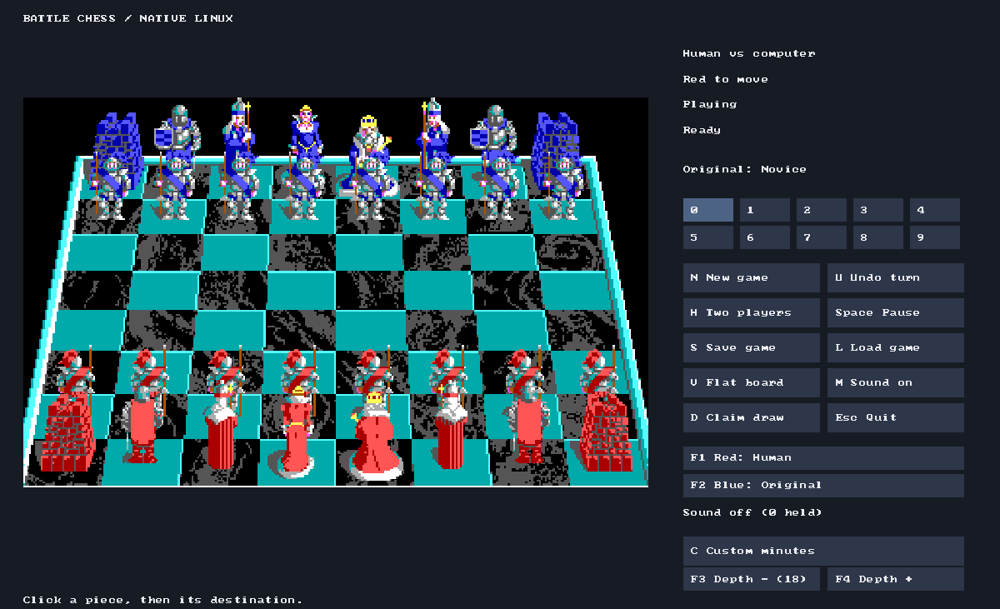
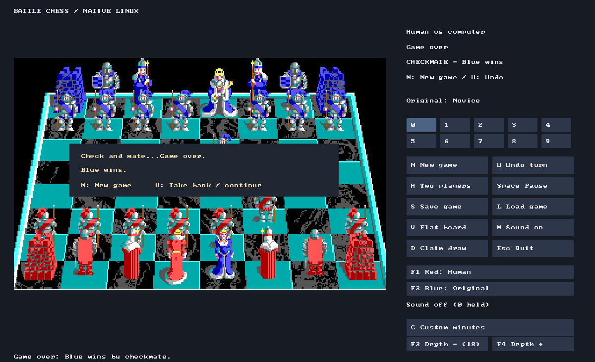

# Battle Chess — matching DOS reconstruction and native Linux port

This repository contains three related projects: a **byte-exact reconstruction
of the original DOS executable**, recovered game assets, and a **playable native
Linux port** built from the recovered code and assets.

| Component | Location | What it contains |
| --- | --- | --- |
| Reconstructed original source | [`matching/src/`](matching/src/) and [`matching/asm/`](matching/asm/) | Recovered C plus authored assembly for the matching DOS build |
| Original build and verification | [`matching/build_exact.py`](matching/build_exact.py), [`matching/build_pipeline/`](matching/build_pipeline/), [`verification/`](verification/) | Source-generation, original-toolchain linking, byte/relocation comparisons and evidence |
| Recovered assets | [`assets/`](assets/README.md) | Sprites, backgrounds, fonts, sound, animation metadata and byte-exact bank rebuilding |
| Native Linux port | [`native/`](native/README.md) | C/SDL3 game, original engine, optional Stockfish, rendering, audio and tests |
| Screenshots | [`docs/screenshots/`](docs/screenshots/) | Actual captures of the Linux port |

**Byte parity:** the reconstructed DOS source produced a complete **83,415-byte
`CHESS.EXE` identical to the original**, including the packed bytes and relocation
order. The exact hash and evidence are below. This is a mixed C/assembly result,
not a claim that every function is recovered C. **The Linux port is a source
adaptation, not a byte-identical DOS executable or proof of complete behavioural
parity.** Its platform/UI changes and fidelity boundaries are documented in the
[native port guide](native/README.md#fidelity-boundaries).

## Play on Linux

Install a C11 compiler, CMake, pkg-config, Python 3 and SDL3 development files
(version 3.2 or newer). Then, from a checkout:

```sh
git clone https://github.com/kierzo89/battle-chess.git
cd battle-chess
./native/run.sh
```

The launcher builds the game and asset packs locally. It runs natively without
DOSBox or `CHESS.EXE`. This is a source release; a prebuilt Linux binary is not
included. Stockfish is an optional separately installed executable.

- Play against the original Battle Chess engine, another human, or Stockfish.
- Select either side's controller with F1/F2, including Stockfish versus Original.
- Stockfish depth is independent of the original engine's difficulty settings.
- Recovered walking, battle and checkmate animations, audio, flat/perspective
  boards, promotion, save/load and undo are supported.

See [controls and build instructions](native/README.md) and the
[validation and fidelity record](native/COMPLETION_AUDIT.md).

## Screenshots

Native perspective board with independent engine selectors and Stockfish depth:



The recovered king-defeat sequence ends with the original game-over wording:



These are screenshots of the Linux port, not the original DOS interface.

## Verified result — 1 November 2026

The final **fresh source-derived build reproduced all 83,415 bytes** of the original `CHESS.EXE`:

```text
SHA-256 c32d4f6bc732b67efa65d55bc5813bc74dcfb52b8616894b57ed7aeeeed2a1cd
Expanded image: 401,131 bytes
Native relocation entries: 173, exact in original EXEPACK emission order
Fresh build time on the development machine: 224.87 seconds
```

REA-controlled runtime checks covered startup artwork, the animated board, a legal move, an opponent reply, and saving/loading the position across separate launches. These were smoke tests, not exhaustive game-rule or audio tests.

**This is a mixed C/assembly reconstruction, not 100% recovered C.** The separately accepted component checkpoint records 255 C functions / 48,482 C code bytes and approximately 82.77% original-file component coverage. Complete executable identity is a separate result. Authentic historical runtime-library members are external inputs and are not credited as decompiled C. Some reconstructed data and code providers are explicitly assembly.

## Recovered assets

The [asset bundle](assets/README.md) includes graphics, fonts, audio data, animation metadata and a portable Python script that reconstructs both original asset banks byte-for-byte. These files are loaded by the game separately from `CHESS.EXE`.

## Where to look

- [`matching/src/`](matching/src/): reconstructed C sources.
- [`matching/asm/`](matching/asm/): authored assembly providers.
- [`matching/build_pipeline/`](matching/build_pipeline/): pinned source-generation and verification pipeline.
- [`matching/build_exact.py`](matching/build_exact.py): adopted final build launcher.
- [Final source bundle](.reworkbench/staging/exact-build-driver-v2/): frozen C/assembly overrides, source-order recipes, original LINK/EXEPACK driver and hash manifest. The historical `staging` directory name and manifest status are retained to preserve their hashes; the separate acceptance review records adoption.
- [`matching/tests/`](matching/tests/): verifier and reconstruction tests.
- [`verification/exact-build-report.json`](verification/exact-build-report.json): final fresh-build result.
- [Acceptance review](.reworkbench/reviews/exact-executable-v2.json) and [provider attribution](.reworkbench/staging/exact-build-integration-v1/final-provider-attribution.json): evidence and credit boundaries.

Older checkpoint documents describe intermediate states; their percentages and unresolved tasks are historical.

## DOS matching build and reproducibility limits

The DOS reconstruction is a **source/evidence snapshot of the verified workspace**, not yet a turnkey portable DOS build distribution. The Linux port has its own build instructions above. The frozen recipes retain `/home/kierzo/chess` paths and exact dependency hashes. Do not simply rewrite those paths or regenerate manifests and treat the result as already verified.

The original workspace command is:

```sh
/usr/bin/python3 -B matching/build_exact.py \
  --output /home/kierzo/chess/matching/build/NEW_NAME
```

Both `NEW_NAME` and its `NEW_NAME-source269` sibling must be new directories. The pipeline uses eight isolated compile workers, then serial original linking and packing. It compares the complete result against the original executable without granting automatic component credit.

A fresh checkout **cannot run that build until external dependencies and omitted binary evidence are supplied**:

- Original `CHESS.EXE` for independent comparison; recovered runtime assets are now provided under [`assets/`](assets/README.md).
- Pinned Microsoft C 5.00/5.10 tools, assembler, LINK/EXEPACK, runtime libraries, original `LIB.EXE` and `BINMODE.OBJ`.
- The pinned DOSBox and NASM builds recorded in `matching/build_pipeline/manifest.json`.
- The Python environment at `matching/build/test-env/bin/python`, including test dependencies in `matching/requirements-dev.txt`.
- Binary evidence inputs listed in [`verification/external-inputs.json`](verification/external-inputs.json). This inventory lists manifest omissions, not a complete automatic installation procedure.

Existing `matching/setup_toolchain.py`, `setup_runtime.py` and `setup_libh.py` document pinned historical tool acquisition. Recovered game assets and their portable bank rebuilder are now published under [`assets/`](assets/README.md). Executable binaries, toolchains, runtime libraries, generated objects, model weights, credentials and the Workbench database are deliberately not published here. The original full evidence corpus also remains local; review documents may reference paths absent from this snapshot.

To verify the published snapshot itself, without external tools:

```sh
python3 tools/verify_source_snapshot.py
```

This checks file integrity and accounts for every pinned base-build and final-bundle input. It does **not** claim a fresh executable build.

## Rights and provenance

This repository contains a reverse-engineered reconstruction. It includes recovered original asset data but does not grant rights to the original game or its artwork/audio. Proprietary compiler/runtime distributions are not included. No blanket license is asserted over those third-party materials. Source attribution and assembly-versus-C distinctions are retained in the verification records.
